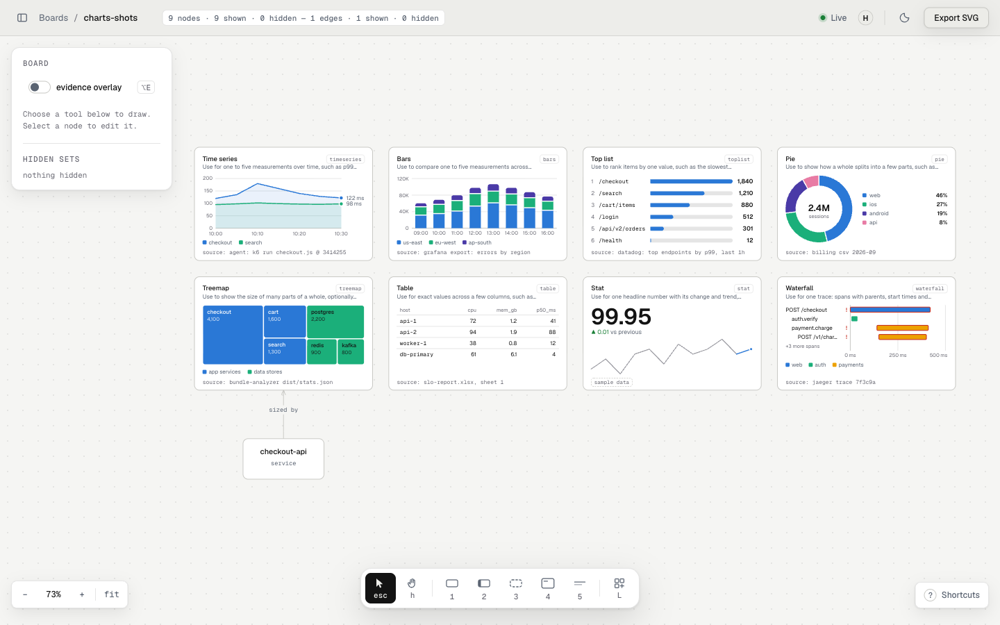

<p align="center">
  
</p>

<h1 align="center">draw</h1>

<p align="center">
  By redcrayon. A live architecture board you and your coding agent draw on together.<br>
  The agent draws what it builds. You read the board instead of a prose summary.
</p>

<picture>
  <source media="(prefers-color-scheme: dark)" srcset=".github/assets/hero-dark.png">
  
</picture>

## Install

**Server URL:** `https://mcp.redcrayon.ai/mcp`. Every client signs in once, in the browser.

### Claude Code

```sh
claude plugin marketplace add redcrayonai/draw
claude plugin install draw@redcrayonai
```

Run `/mcp`, choose **redcrayon**, **Authenticate**. Then `/draw:navigate`: the agent opens a board named after your branch and posts its link.

The plugin fills in code refs for you. They need git and Node 20+; drawing works without.

### Cursor

`~/.cursor/mcp.json`:

```json
{ "mcpServers": { "redcrayon": { "url": "https://mcp.redcrayon.ai/mcp" } } }
```

**Cursor Settings → MCP**, click login next to redcrayon.

### Codex

```sh
codex mcp add redcrayon --url https://mcp.redcrayon.ai/mcp
codex mcp login redcrayon
```

### claude.ai

**Customize → Connectors → Add custom connector**, name it redcrayon, paste the server URL, **Connect**.

### Any other MCP client

Give it the server URL. For code refs outside Claude Code, the agent runs the capture helper when a tool asks; nothing to install:

```sh
npx -y @redcrayonai/draw@1 doctor   # check node, git, repo, network
```

## What to ask

### Watch it build

```text
Add rate limiting to the public API. Draw what you change on a redcrayon board.
```

The components it is about to change, drawn before the first edit. Every edge cites the line that proves it; every symbol it touches has a code ref.

### Review a risky change

```text
Drop the unused customers.name column. Flag the migration on the board and cite every reader of that column.
```

The migration is flagged on the database. A reader it did not update shows as one that will break.

### Map an unfamiliar codebase

```text
Draw how this repo fits together: entry points, services, data stores and the calls between them. Cite a line for every edge.
```

An onboarding map, left to right, each box with a two-sentence doc. Share it as a view link.

### Investigate an incident

```text
Pods in checkout keep restarting since 14:00. Pull the restarts and error rates, and lay out what you find on a scratch board.
```

Charts beside the services they describe, each saying where its data came from. Pairs with a Grafana or Kubernetes MCP server.

### Triage security findings

```text
Here is this morning's SIEM alert and the scanner report. Mark what they affect on the architecture board, and tell me what to fix first.
```

Compromised and vulnerable services marked, each with its blast radius. Fix the widest one first.

## What leaves your machine

Drawing sends what the agent draws: nodes, edges, labels. Code refs and checkpoints also send the files the board cites; draw keeps the cited lines, the path and the git hash, and deletes the file within 10 minutes.

Never sent: your file list, uncited files, diff text, files git ignores, secrets such as `.env` and key files. Full list: [plugin/README.md](plugin/README.md#what-leaves-your-machine).

## Your own server

```sh
REDCRAYON_MCP_URL=http://localhost:8788/mcp claude
```

Other clients take that URL in place of the hosted one. Self-hosting instructions ship with the open-source core.

## License

The plugin is MIT ([plugin/LICENSE](plugin/LICENSE)).
