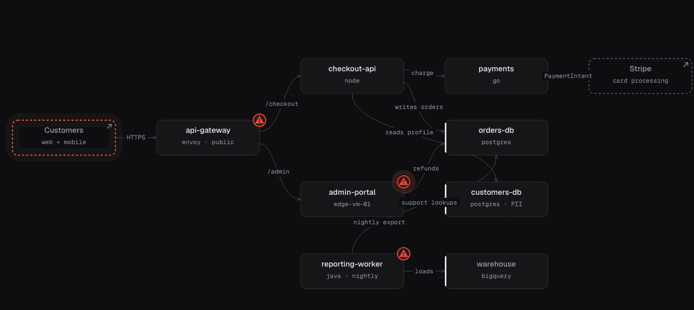
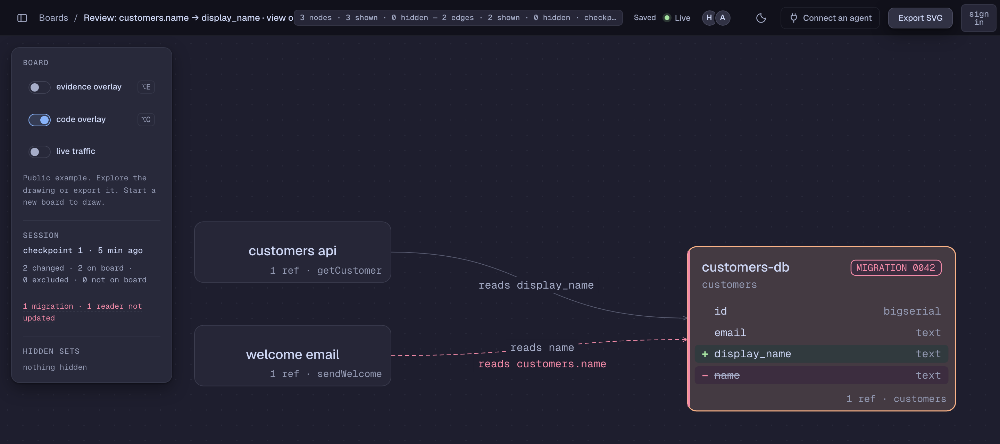
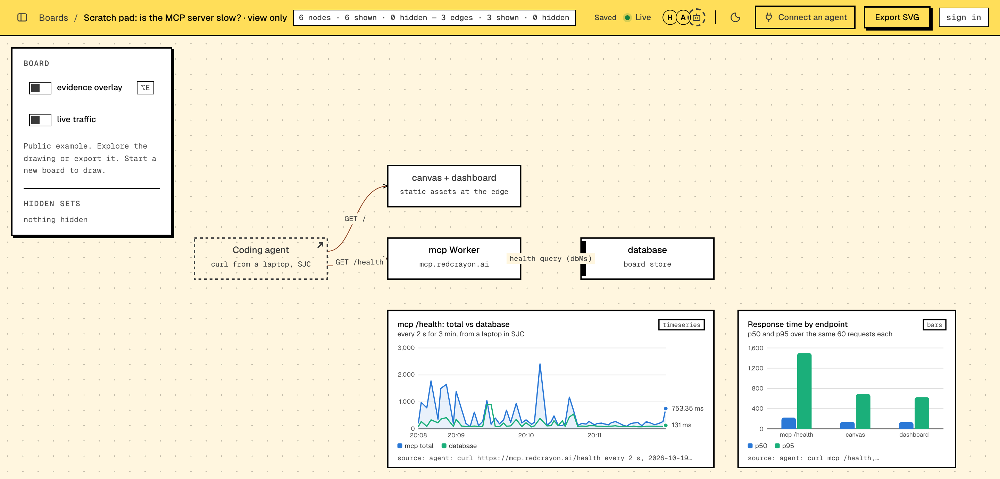

<div align="center">


<h1>draw</h1>

**A live architecture board you and your coding agent draw on together.<br>The agent draws what it builds. You read the board, not a prose summary.**

[](https://www.npmjs.com/package/@redcrayonai/draw)
[](#install)
[](LICENSE)

**[Install](#install) · [What to ask](#what-to-ask) · [Demos](#review-a-risky-change) · [What leaves your machine](#what-leaves-your-machine)**

<code>claude plugin marketplace add redcrayonai/draw && claude plugin install draw@redcrayonai</code>

<br><br>

<a href="https://draw.redcrayon.ai/#s=0e265bfd5eee31353e7cc39ec824771e"></a>

<sub>One request replayed hop by hop (<code>play_trace</code>). By redcrayon.</sub>

</div>

<br>

Ask your agent in plain words:

- *"Add rate limiting to the public API. Draw what you change on a redcrayon board."*
- *"Draw how this repo fits together. Cite a line for every edge."*
- *"Drop the unused customers.name column. Flag the migration and cite every reader."*
- *"Pods in checkout keep restarting since 14:00. Lay out what you find on a scratch board."*
- *"Mark what this SIEM alert and scanner report affect, and tell me what to fix first."*

The agent opens a board named after your branch, posts the link, and keeps it current as it works.

---

## Install

**Claude Code** (board tools, `/draw:navigate`, and code refs filled in for you):

```text
/plugin marketplace add redcrayonai/draw
/plugin install draw@redcrayonai
```

Then `/mcp` → **redcrayon** → **Authenticate**, and run `/draw:navigate`.

<details>
<summary><b>Cursor</b></summary>

`~/.cursor/mcp.json`:

```json
{ "mcpServers": { "redcrayon": { "url": "https://mcp.redcrayon.ai/mcp" } } }
```

**Cursor Settings → MCP**, click login next to redcrayon.

</details>

<details>
<summary><b>Codex</b></summary>

```sh
codex mcp add redcrayon --url https://mcp.redcrayon.ai/mcp
codex mcp login redcrayon
```

</details>

<details>
<summary><b>claude.ai</b></summary>

**Customize → Connectors → Add custom connector**, name it redcrayon, paste `https://mcp.redcrayon.ai/mcp`, **Connect**. claude.ai draws from the conversation; code refs need a coding agent in your project.

</details>

<details>
<summary><b>Any other MCP client</b></summary>

Give it `https://mcp.redcrayon.ai/mcp`. Every client signs in once, in the browser.

Code refs outside Claude Code: when a tool needs a capture of your checkout, it tells the agent the exact command, and the agent runs it. Nothing to install; Node 20+ and git on PATH.

```sh
npx -y @redcrayonai/draw@1 doctor   # check node, git, repo, network
```

</details>

## What to ask

| Ask | You get |
|---|---|
| **Watch it build**<br>*"Add rate limiting to the public API. Draw what you change."* | The components it is about to change, drawn before the first edit. Every edge cites the line that proves it; every symbol it touches has a code ref. |
| **Review a risky change**<br>*"Drop customers.name. Flag the migration and cite every reader."* | The migration flagged on the database. A reader it did not update shows as one that will break. |
| **Map a codebase**<br>*"Draw how this repo fits together. Cite a line for every edge."* | An onboarding map, left to right, each box with a two-sentence doc. Share it as a view link. |
| **Investigate an incident**<br>*"Checkout pods keep restarting. Lay out what you find."* | Charts beside the services they describe, each saying where its data came from. Pairs with a Grafana or Kubernetes MCP server. |
| **Triage security findings**<br>*"Mark what this alert and scan affect. What do I fix first?"* | Compromised and vulnerable services marked, each with its blast radius. Fix the widest one first. |

### Review a risky change

<a href="https://draw.redcrayon.ai/#s=8a2555d85c7fe7728811f82770b9cedf"></a>

Migration 0042 replaces `customers.name` with `display_name`. The board shows the table's new shape, the step that can't be undone, and the one reader the change missed: the welcome email still selects `name`. Code refs open the exact lines.

**[Open the demo board →](https://draw.redcrayon.ai/#s=8a2555d85c7fe7728811f82770b9cedf)** <sub>Catppuccin Mocha theme</sub>

### Investigate an incident

<a href="https://draw.redcrayon.ai/#s=32b61159274bbf0f64f1d64bdd278234"></a>

A scratch pad beside the services it explains: 60 real requests to `/health`, total time against the database time it reports, and p50/p95 per endpoint. The slow tail isn't the database. Every chart says where its numbers came from.

**[Open the demo board →](https://draw.redcrayon.ai/#s=32b61159274bbf0f64f1d64bdd278234)** <sub>Neo-brutalism theme</sub>

### Triage security findings

<a href="https://draw.redcrayon.ai/#s=0e265bfd5eee31353e7cc39ec824771e"></a>

A SIEM alert marks **admin-portal** compromised; scanner findings mark the gateway and a worker vulnerable. Open a ⚠ marker to see what it reaches and what trusts it, hop by hop.

**[Open the demo board →](https://draw.redcrayon.ai/#s=0e265bfd5eee31353e7cc39ec824771e)** Click a ⚠ marker, then **play spread**. <sub>Dark theme</sub>

Thirteen themes, from Neo-brutalism to Nord: pick one from the board header.

## What leaves your machine

Drawing sends what the agent draws: nodes, edges, labels. Code refs and checkpoints also send the files the board cites; draw keeps the cited lines, the path and the git hash, and deletes the file within 10 minutes.

Never sent: your file list, uncited files, diff text, files git ignores, secrets such as `.env` and key files. Full list: [plugin/README.md](plugin/README.md#what-leaves-your-machine).

## Your own server

```sh
REDCRAYON_MCP_URL=http://localhost:8788/mcp claude
```

Other clients take that URL in place of the hosted one. Self-hosting instructions ship with the open-source core.

## License

Apache License 2.0. See [LICENSE](LICENSE).
