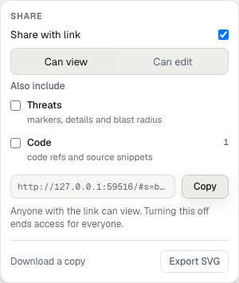

A board is a live canvas of components and the flows between them. You and your
agent see each other's edits, cursor and selection. Notes and text blocks add
explanations beside the diagram.


A sample request path in the local app. Code-ref badges connect components to their code.

## Start a board

```text
Open a draw board for this task and post its link. Draw what you build as you go.
```

The agent calls `start_session` and posts the board link. Boards opened by your
linked agent belong to you. A drawing-only board works without a local checkout.
Code refs and checkpoints need a session tied to your checkout.

Every write uses the same drawing rules: a 4px grid, at most two focal nodes,
and a fixed set of colors. A refused write explains the rule it breaks.

## Read the evidence

An agent can hide imported components in named groups. The board counts hidden
nodes and provides controls to show them again. It does not silently delete
imported architecture. Connections without current evidence remain visible as
unverified claims.

Use the [red crayon](/use-cases/feedback/) to send feedback on a node.
Use a [branch](/capabilities/branches/) to propose a different design.

## Sharing

A personal board starts private. Workspace boards follow their
[workspace and board grants](/capabilities/workspaces/).
The access line under the board name describes your current access.

1. Open **Share** and enable **Share with link**.
2. Choose **Can view** or **Can edit**.
3. Choose whether to include **Threats** or **Code**.
4. Copy the share link to the intended reader.

| Link | What readers can do |
|---|---|
| Can view | Anyone holding the link can view included content, without sign-in. |
| Can edit | Anyone holding the link can view. Signed-in readers can also edit. |

New view links exclude **Threats** and **Code** by default. Threats includes
markers, details and blast radius. Code includes ref metadata and any stored
snippets. **Edit links always include code**, because undo can restore edited content.

Code sharing does not enable snippet storage. The owner's
[code consent](/data-and-consent/) controls whether snippet text exists.
With storage off, code access still exposes paths, symbols, line ranges and repository names.

The header's exposure control opens the sharing choices so you can inspect
what a link includes. Turning off link sharing revokes that link. It does not
remove workspace grants, public access or separately enabled embeds.



A view link with both sensitive layers excluded.

## Share less than the whole board

A [chart embed](/capabilities/embeds/) publishes one chart without granting board
access. A board embed publishes the visible diagram through a separate link.
Disabling a board share link does not disable either embed.

## Keep or delete a board

In the [dashboard](/dashboard/), click a board tile to open its details panel.
Use the board name or **Open in canvas** to open the drawing. Rename, delete,
sharing and workspace access controls appear in the details panel when your role permits them.

Keep a scratch board for a write-up, or delete it from the dashboard. Boards do
not expire automatically. The command palette also provides deletion where your
access allows it. Saved library items need separate deletion.

[Share an explanation](/use-cases/share/) · [MCP tools](/reference/mcp-tools/)
