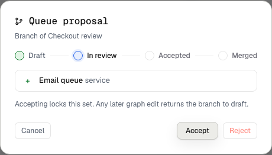

A branch is a copy of a board for a proposed change. It has its own id and link.
The base diagram stays as it is until a person merges the branch.

## Ask your agent

```text
Branch this board as queue-proposal. Draw an asynchronous worker instead of the direct call, then submit it for review.
```

`create_branch` copies nodes, edges, icons, charts, hidden sets and code refs.
It also copies change notes with their review state reset.
The copy does not carry the base session, route or threats.
The agent uses the returned id for edits and calls `submit_branch` when ready.



A submitted sample branch waits for a person's review.

## Review in the canvas

Open **Branches** beside the board name. The review shows added, removed and
changed components and the available actions.

- An ordinary board branch can merge into its base. The merge keeps unrelated additions made after branching.
- A proposal against an imported snapshot can be accepted or rejected. **Check latest import** compares it with the next factual import.
- A graph edit after submission or acceptance returns the proposal to draft.

The owner performs review and merge actions. Agents submit proposals but cannot
approve or merge them. A board merge changes the diagram. It does not merge a
Git branch or deploy code.

[Propose an architecture change](/use-cases/propose/) · [MCP tools](/reference/mcp-tools/)
