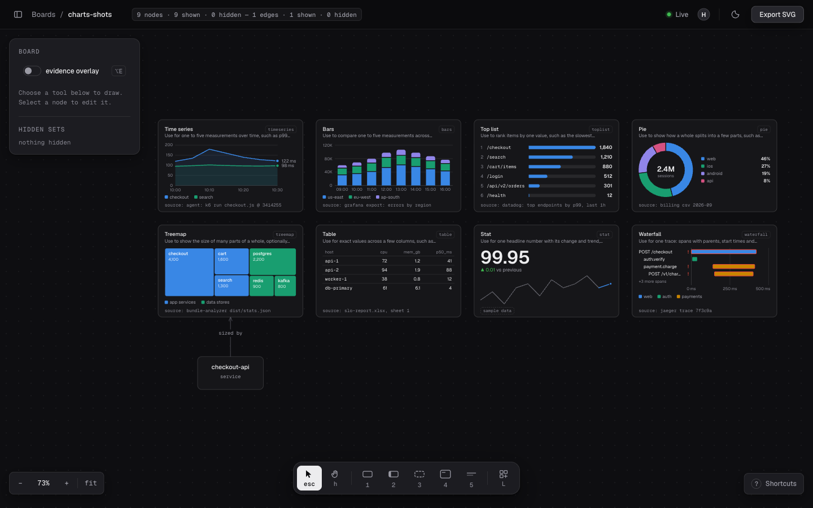
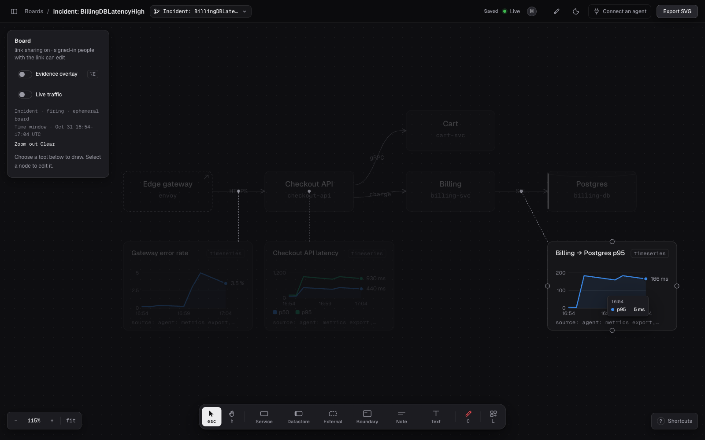

A chart is a node that holds data, drawn beside the components it is about.
There are 11 types: `timeseries`, `bars`, `toplist`, `pie`, `treemap`, `table`,
`stat`, `waterfall`, `scatter`, `schedule` and `kanban`.



## Ask your agent

```text
Chart the p95 latency of the checkout API over the last hour, next to its node.
```

## What the agent does

- `describe_charts` reads what each type takes.
- `create_chart` adds the chart from CSV data, with a source that says where
  the data came from, for example `agent: npm run bench @ <sha>`. An agent must
  always give one.
- `set_chart_data` updates it.

Hover a chart for the value under the pointer. Press `L` for the library: place
any type with example data, or save your own selections to reuse.

## Pin a chart to what it measures

A pinned chart draws a dashed lead to the middle of an edge or the centre of a
component, so a latency chart stays attached to the hop it measures. Pick the
target under **Pinned to** in the chart's inspector, or ask the agent:

```text
Pin the billing to postgres latency chart to that edge.
```

Pinning again moves the pin. Deleting the chart, the edge or the component
removes it.

## Share a time window

A board can hold one time window. Every time chart on it then shows only that
range, for everyone viewing the board, so a whole room reads the same minutes.



- Hold **Alt** and drag across a time chart to set the window.
- **Zoom out** in the rail doubles it around its centre. **Clear** removes it.
- Times are UTC, like the chart axes.
- A chart with no points in the window reads *outside the time window*.

Only time charts with dates follow the window. Clock times (`HH:MM`) and other
chart types do not change. A window is at most 31 days wide. You need edit
access to change it.

## Limits

- A chart is at least 224x144.
- The CSV is at most 32 KB, with at most 5 series. Units go in the `unit`
  option, not in the cells.

Tools: `describe_charts`, `create_chart`, `set_chart_data`, `get_chart`, `pin_chart`, `set_time_window`.
