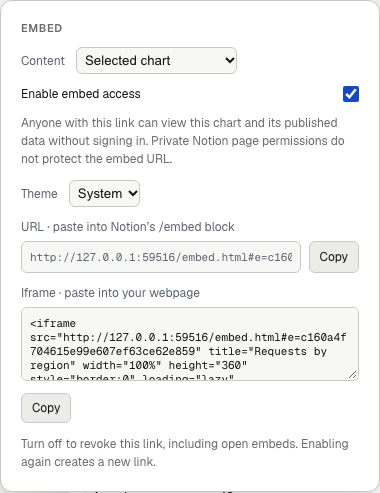

An embed shows a chart or diagram inside another page. It updates as the source
changes and uses its own access link. Board sharing can stay off.

## Publish a chart or board

1. As the board owner, select a chart and choose **Embed chart**.
2. For a diagram, choose **Embed board**, or select **Whole board / diagram** under **Content**.
3. Inspect the disclosure of what the embed publishes.
4. Enable **Enable embed access**.
5. Choose **System**, **Light** or **Dark**.
6. Copy the URL for an embed block, or the iframe HTML for a webpage.

For Notion, use `/embed` and paste the URL. Use a publicly reachable HTTPS
server. A localhost URL works only on devices that can reach that server.
Notion web, desktop and mobile compatibility still needs platform verification.

The owner enables access and copies a separate embed link.

## What becomes readable

| Embed | Published content |
|---|---|
| Selected chart | Title, subtitle, type, complete CSV, chart options and source |
| Whole board | Visible labels, connections and charts, including later changes |

Hidden nodes and edges stay excluded from a board embed. Embeds do not publish
code refs, node docs, source citations, repository files, editor presence or
change-note overlays.

For a board, **Include threat playback** additionally publishes active threat
titles, stages, severity and affected anchors. **Include previous architecture
snapshot** publishes the prior diagram as well. Both choices start off.

Anyone holding an embed URL can read its published content without signing in.
A private page containing the embed does not protect that URL. Chart and board
embed links are independent of each other and of board sharing.

## Playback and accessibility

Chart viewers offer tooltips, **View data**, animation pause and replay.
Diagram viewers offer pan, zoom, **Play**, **Pause**, **Replay** and optional **Loop**.
Playback can show connection flows, a planned route, included threats or an
included architecture comparison. Diagram playback starts paused.

The viewer pauses motion while offscreen or in a hidden tab. Reduced-motion
settings show a static result. Pausing animation does not pause live data updates.

The viewer uses sample data here. It does not expose the board editor or neighboring components.

## Revoke access

Turn off **Enable embed access** for that chart or board. Open viewers clear the
published content. Enabling it again creates a fresh link. The old link stays invalid.
Deleting a published chart or board also revokes its embed.

Revocation cannot retract saved copies. Inspect chart CSV and source labels
before publishing. Code consent does not redact those fields.

[Share an explanation or report](/use-cases/share/) · [Data and consent](/data-and-consent/)
