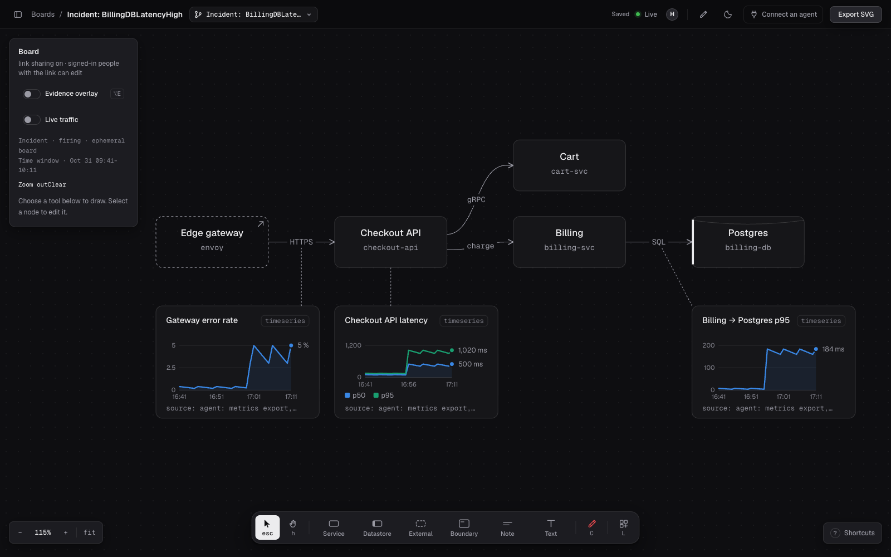

An incident board is a copy of a board you already keep, opened by an alert.
Responders get the drawing, its charts and their pins without drawing anything
during the incident. Each board is flagged ephemeral. Nothing deletes ephemeral
boards yet; delete one when you no longer need it.



A local demo with synthetic data.

## What the alert does

When an alert fires for a board, draw:

1. Copies that board's nodes, edges, charts and chart pins into a new board in
   the same workspace. The new board is named `Incident: <alertname>`.
2. Clears focal on every copied node, so the room starts with no suspects.
   A board holds at most two focal nodes, so naming a third means demoting one.
3. Sets the board's [time window](/capabilities/charts/#share-a-time-window) to
   15 minutes either side of the alert's start, so every time chart opens on it.
4. Gives the same access as the source board: the workspace's default role and
   the members and teams the source board grants.

A repeated notification for the same alert group finds the open incident
instead of copying again. A `resolved` notification closes it. If the group
fires again within an hour, its board reopens; after that, a new incident board opens. A board has at most 20 open
incidents, and an incident board cannot open incidents of its own.

The rail shows `Incident · firing` or `Incident · resolved` beside the window.

## Connect an alert

You need a shared workspace and a service account API key with **Edit** access
to the board the alert should copy. See
[Give automation a scoped key](/capabilities/workspaces/#give-automation-a-scoped-key).

The endpoint takes the Alertmanager webhook format. Use the board's link id,
the part after `#b=` in its link:

```yaml
receivers:
  - name: draw
    webhook_configs:
      - url: https://mcp.redcrayon.ai/hooks/alert?board=<link id>
        send_resolved: true
        http_config:
          authorization:
            credentials: <API key>
```

draw reads `groupKey`, `status`, `commonLabels.alertname` and the earliest
`alerts[].startsAt`. It ignores other labels and annotations.

The response names the incident board:

```json
{ "status": "firing", "board": "<link id>", "url": "https://draw.redcrayon.ai/#b=<link id>" }
```

Alertmanager does not read this response. Responders find the board in the
workspace's board list. To post the link in chat, send the alert through a tool
that reads the response, or find it in the [dashboard](/dashboard/).

## Refusals

| Status | Meaning |
|---|---|
| 400 | The body is not an alert webhook: no `groupKey`, or a status other than `firing` or `resolved`. |
| 401 | No key, or the key is revoked or expired. |
| 403 | The key cannot edit the board, or the board refuses the incident. The body says why. |
| 404 | No board this key can read has that link id. |
| 413 | The body is larger than 64 KB. |

Browsers cannot call the endpoint.

## Work the incident

With [the draw plugin](/connect/#claude-code), hand the board to your agent:

```text
/draw:triage <incident board link> checkout errors since the deploy
```

Given a lasting board, the agent first opens an incident board from it with
`open_incident`, so its charts never land on the original. Given an incident
board, it works there. Then it reads the board, pulls measurements from the monitoring tools you
connected, charts them beside the hops they describe and pins each chart there.
It may narrow the time window and says when it does. It does not mark suspects.

- Mark at most two suspects with focal. Demote one before naming another.
- Narrow the window: hold **Alt** and drag across any time chart.
- Turn on [Live traffic](/capabilities/traffic/) with a local tap, and save the
  last 15 minutes as charts pinned to each edge.
- The board's activity records who changed what and when.

[Charts](/capabilities/charts/) · [Live traffic](/capabilities/traffic/) ·
[Investigate an incident](/use-cases/investigate/)
