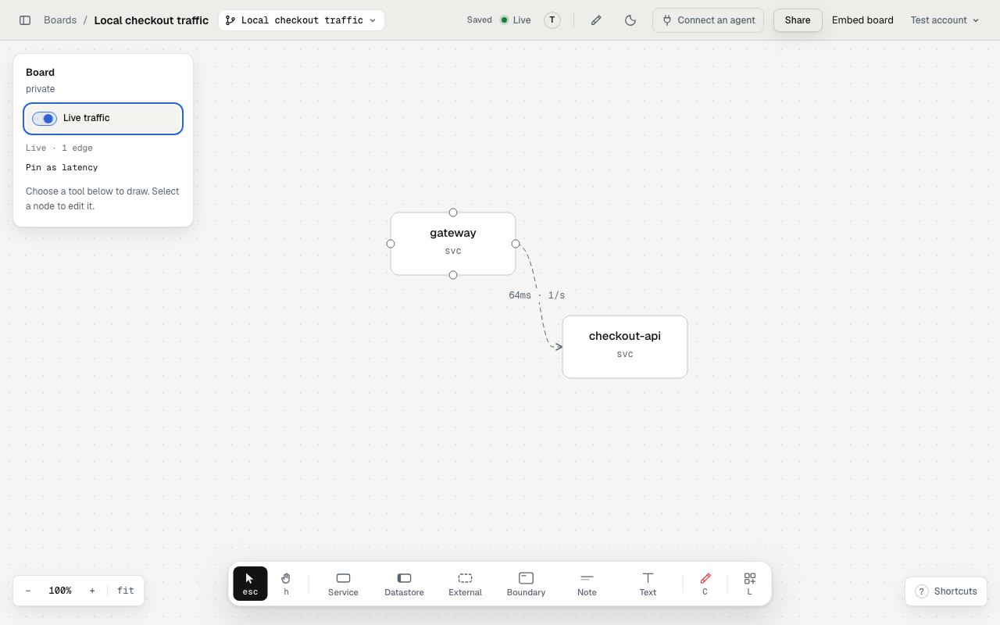

A live tap receives traces from your local app and shows measurements on existing
board edges. [Watch local traffic with tap](/use-cases/tap/) has prompts for request
flows, intermittent errors and before/after comparisons.

## Choose the right tool

| You need | Ask the agent to use |
|---|---|
| Traffic while you exercise a local app | `start_tap` and the local helper |
| One request explained span by span | `play_trace` with an existing trace |
| A latency label on one connection | `set_edge_latency` with a measured value or explicit estimate |

## Start a live tap

You need Node **22 or later**, an agent with edit access to the board, and an
app with an OpenTelemetry trace SDK or exporter. Setting environment variables
alone does not add instrumentation. Managed service accounts cannot start taps.

1. Draw the services and connections on the board.
2. Ask the agent to call `start_tap` for that board.
3. Have it write `.redcrayon/tap.json` in your project root.
4. Run the exact helper command that `start_tap` returns from that directory.
5. Start your instrumented app with the exporter settings below.
6. Turn on **Live traffic** in the board's left rail.

Example mapping, with illustrative ids:

```json
{
  "board": "42",
  "services": {
    "gateway": "10",
    "checkout-api": "11",
    "payments-api": "12"
  }
}
```

Replace the board and node ids with the ones your agent draws. Each key must
match the resource's `service.name`, not a hostname, route or display label.
The helper rereads this file after edits, so you can correct mappings without restarting it.

The returned command includes a board-scoped token:

```sh
npx -y @redcrayonai/draw@1 tap --token 'TOKEN_FROM_START_TAP'
```

The token lasts 12 hours. Keep it out of committed files and shared logs.
One tap can connect to a board at a time.

## Configure an instrumented service

For an SDK that supports environment settings, use these in the shell that
starts `checkout-api`:

```sh
export OTEL_SERVICE_NAME=checkout-api
export OTEL_EXPORTER_OTLP_TRACES_ENDPOINT=http://127.0.0.1:4318/v1/traces
export OTEL_EXPORTER_OTLP_TRACES_PROTOCOL=http/protobuf
```

Use `gateway` and `payments-api` as the service names in the other two processes.
Start each process with its usual command. Trace-specific settings leave your
metrics and logs endpoints unchanged. Environment support varies by SDK. See
[OpenTelemetry exporter settings](https://opentelemetry.io/docs/languages/sdk-configuration/otlp-exporter/).

The receiver accepts OTLP over **HTTP**, not gRPC, at `/v1/traces`. It supports
protobuf and JSON. The general `OTEL_EXPORTER_OTLP_ENDPOINT` uses the base URL
`http://127.0.0.1:4318`; a trace-specific endpoint includes `/v1/traces` as shown above.

Run the services and helper on the same host for this recipe. The helper binds
to loopback only. Inside a container, `127.0.0.1` points to that container, so a
containerized exporter needs networking that reaches the helper's loopback listener.

## Send a synthetic test request

First start the tap, map `gateway` and `checkout-api`, draw a connection between
their nodes, and switch on Live. Save [tap-smoke.json](/examples/tap-smoke.json)
as `tap-smoke.json` in your working directory. Then run:

```sh
curl --fail --show-error \
  -H 'Content-Type: application/json' \
  --data-binary @tap-smoke.json \
  http://127.0.0.1:4318/v1/traces
```

This sends two synthetic parent/child spans. The expected result is one
`gateway → checkout-api` sample with a 64 ms child duration and no errors.
The receiver answers `{}`. Hover the drawn connection to inspect the live values.
Run the command again to produce another window. To simulate an error, change
the checkout span's `status.code` from `1` to `2` and resend it. These are test
values, not app measurements.

## Read the result

The helper summarizes cross-service parent/child spans about once a second.
The board matches their node pairs to drawn connections. Hover a node or edge
for request rate, median (p50) latency and errors. Latency is the child span's duration
as the receiving service observed it, not an independent measurement of network time.

Both services must export related spans to the tap. Same-service spans do not
create hops. A database client span inside `checkout-api` does not create a
separate Redis hop from its attributes. Trace context must propagate between
services. See [context propagation](https://opentelemetry.io/docs/concepts/context-propagation/).

Sampling and export batching affect what arrives. Old live values clear after
about three seconds without a new window. The live channel stores no history.
Use a chart or your tracing system to keep a comparison.

The helper computes p95 and maximum durations too, but current edge labels show
p50. Use your tracing tool for a tail-latency analysis. With edit access,
**Pin as latency** saves the latest median on each observed edge as a `local`
measurement. It remains after Live is off, without saving rates or a history.



This local capture uses the synthetic smoke-test payload and a simulated channel.

## If nothing moves

| Symptom | What to check |
|---|---|
| No live source | Start the helper with a fresh `start_tap` token for this board. |
| Tap waits for a viewer | Open the same board and turn on Live traffic. |
| Receiver gets no traces | Check SDK setup, HTTP protocol, endpoint path and the app's network. |
| Unmapped services | Match names in the helper's periodic log to keys in `tap.json`. |
| Spans arrive but no hop appears | Check parent/child context, export from both services, their node ids and the drawn edge. |
| Port 4318 is busy | Add `--port 4320` to the helper command and use port 4320 in the exporter endpoint. |
| Another tap is already live | Stop that helper before starting a replacement. |
| Token expires or access ends | Ask the agent for a new token and restart the helper after restoring access. |

## What leaves your machine

The helper drops span names and attributes locally. It sends node pairs,
counts, error counts and latency summaries only while at least one viewer has
Live on. Raw trace bodies do not leave your machine through the tap.
Code snippet consent is a separate setting. Stopping every viewer pauses
summary transmission; stopping the helper also closes the local receiver.

## Replay one request

For an existing production or local trace, ask:

```text
Replay the slowest checkout trace from the last hour on the board. Use measured timings and mark error spans.
```

The agent needs access to that trace through another tool. `play_trace` sends
only span ids, node ids, parent relationships, timings and status. It does not
start a local tap. `set_edge_latency` marks values as `prod`, `local` or `estimate`.


This animation shows a single-trace replay, not a live tap.
Tools: `set_edge_latency`, `play_trace`, `start_tap`.
