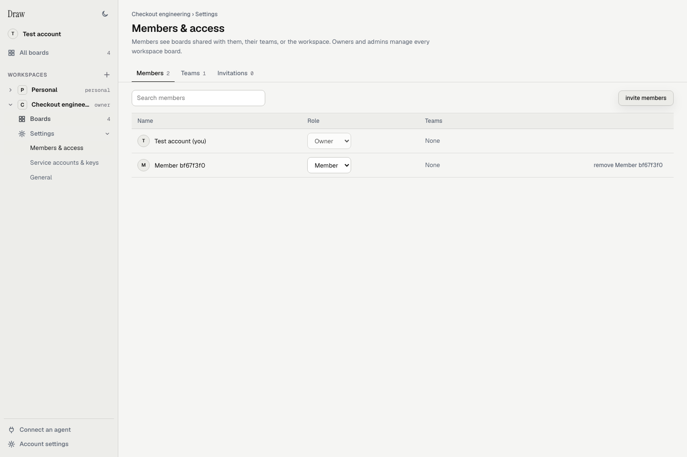
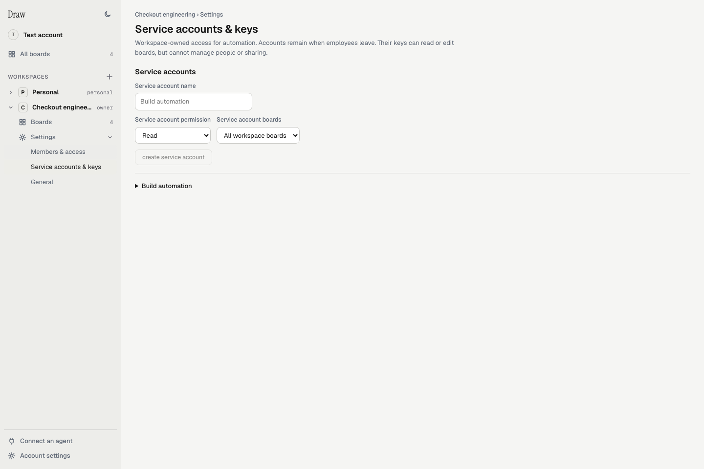

A workspace groups boards and manages access for a company, team or engagement.
Each account can also have a personal workspace. Signing in authenticates a
person. Workspace membership and board grants determine what that person can do.

## Create a workspace

Choose the **+** beside **Workspaces** in the dashboard sidebar. Enter a name
and choose **create workspace**. **Invite people** opens the new workspace's
invitations.

Expand a workspace, then **Settings**, to find its controls:

- **Members & access** has **Members**, **Teams** and **Invitations** tabs.
- **Service accounts & keys** is available to shared-workspace owners and admins.
- **General** shows the workspace name, type and your role. Owners and admins can rename it here.

Choose the workspace's **Boards** entry to see its board gallery.
See [Find and manage your boards](/dashboard/) for board details and account settings.

## Invite a collaborator

1. Expand the workspace in the sidebar, then open **Settings → Members & access**.
2. Choose **Invitations**, or use **invite members** from the Members tab.
3. Choose the invitation role and select **create invitation**.
4. Send the invitation link to the intended person.
5. Ask that person to open the link, sign in and accept it.

Invitations expire after seven days and work once. Workspace managers can revoke
outstanding invitations. Anyone holding an unused invitation can accept it,
so send the link directly to the intended person.

A workspace invitation creates full membership. A board invitation grants that
board and can add guest membership. Full membership alone does not expose private boards.

For one board, select its tile in the gallery. In its details panel, expand
**Access**, then **Invite someone to this board**.
Use the workspace's **Teams** tab to create teams and manage their membership.

## Choose the access

| Role | What it permits |
|---|---|
| Workspace owner or admin | Manage members, teams and workspace-owned boards, subject to owner restrictions |
| Workspace member | Receive workspace-wide, team and direct board grants |
| Workspace guest | Receive explicit board grants |
| Board viewer | Read the board |
| Board editor | Read and edit the board |
| Board manager | Edit, rename, delete and manage board sharing |

The strongest applicable board role wins. Workspace owners and admins can move
boards between workspaces. A move also includes dependent branches or architecture
history. It resets incompatible grants, so inspect access after the move.

Local sample accounts in the current dashboard. Workspace membership has its
own roles. Board grants determine access to individual boards.

## Give automation a scoped key

In a shared workspace, an owner or admin can open
**Settings → Service accounts & keys** from that workspace in the sidebar:

1. Create a named account with **Read** or **Edit** access.
2. Choose all workspace boards or selected boards.
3. Create an API key with the same or narrower access and an optional expiry.
4. Copy the key immediately. The dashboard shows it once.
5. Store the key in your automation's secret store.

The automation sends `Authorization: Bearer <key>` to the MCP endpoint.
Managed keys start with `rcak_`. The service stores only their digest.
For rotation, create a replacement, update the automation, then revoke the old key.

Service accounts operate on existing boards. They cannot create boards, start
traffic taps, manage sharing or memberships, or perform human reviews. Their
current scope caps every key. Revocation and account changes affect existing keys.
Personal workspaces do not have service accounts.

A local sample account named Build automation. No API key is shown.

A linked personal agent is different from a service account. It needs an explicit
board grant, and its linked person must retain edit access. Keep browser session
tokens and infrastructure credentials out of agent instructions.

[Boards and sharing](/capabilities/boards/) · [Data and consent](/data-and-consent/) ·
[Self-host quickstart](/self-host/quickstart/)
