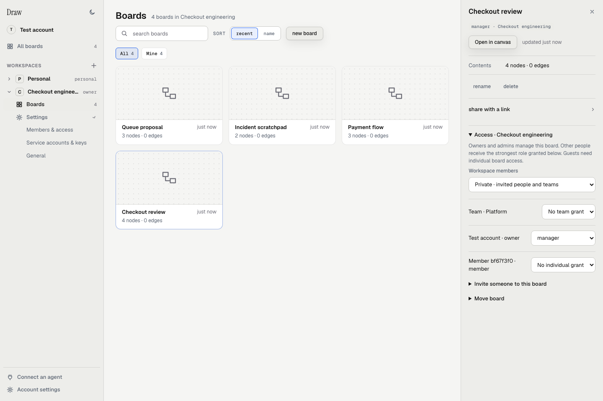

The dashboard groups your boards by workspace. The sidebar holds workspace
settings, agent setup and account settings.

The current dashboard with local sample boards. Select a tile to inspect its
details; click the board's name to open its canvas.

## Find a board

- **All boards** shows the boards you can access across workspaces.
- Expand a workspace in the sidebar, then choose **Boards** to limit the gallery to that workspace.
- **Outside workspaces** appears when you have boards without a workspace.
- Search by board name, use the access filters, or sort by **recent** or **name**.

**Agent sessions** shows up to three session boards updated within the last
hour. Use the checkpoint number and timestamp to judge recency.

To create a board, choose **new board**, enter its name and choose its owner.
After creating it, use **Open in canvas** to start drawing.

## Open board details

Click the tile's illustration to open its details panel. **Open in canvas**
opens the board. Your access determines which management controls appear.

- Use **rename** or **delete** to manage the selected board. Deletion requires typing its name.
- Expand **share with a link** to enable, copy or revoke a board link.
- For a workspace board, expand **Access** to manage workspace, team and individual grants.
- Within access controls, use **Invite someone to this board** for a board invitation, or **Move board** to change its workspace.

Moving a board resets incompatible access grants and requires confirmation. Inspect access
after the move. [Workspaces and access](/capabilities/workspaces/) explains the roles.

Use the canvas **Share** menu to choose whether a link includes **Code** or
**Threats**. [Boards and sharing](/capabilities/boards/#sharing) explains those choices.

## Find the right settings

Expand a workspace and its **Settings** group:

| Control | Where it takes you |
|---|---|
| Members & access | Members, Teams and Invitations tabs for a shared workspace |
| Service accounts & keys | Automation accounts and keys, for shared-workspace owners and admins |
| General | Workspace name, type and your role |

The **+** beside **Workspaces** creates a workspace. Personal workspaces do not
show shared membership or service-account controls.

At the bottom of the sidebar, **Connect an agent** opens the agent setup guide.
**Account settings** holds appearance, linked agents, sign-out and the **Code**
section. Code snippet storage remains off by default; see
[Your data and code consent](/data-and-consent/).

On a narrow screen, choose **Open navigation** to show the sidebar.
