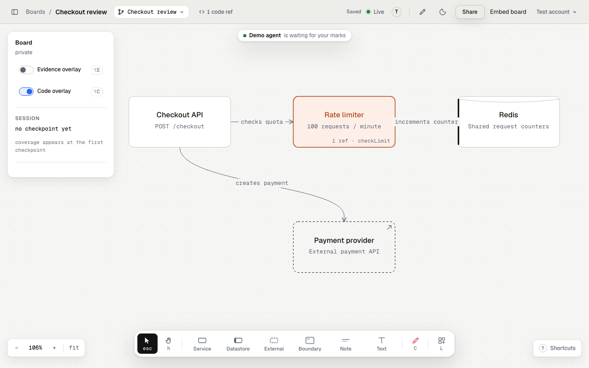

Use this when you want to understand a change while the agent works. Start with
one task, such as rate limiting, rather than a map of the entire repository.

## You ask

```text
Add rate limiting to the public API. Open a draw board for this branch and post its link first. Draw the request path before editing. Cite the code behind each connection, and show which changed files the board covers before you finish.
```

[Connect your agent](/connect/) first. In Claude Code, start with
`/draw:navigate` and give it the task.

## What happens

1. The agent opens a board and posts its link. You can keep the canvas beside your editor.
2. It draws the API, limiter and backing store before its first edit.
3. It cites the calls between components and adds code refs for the functions it changes.
4. At a checkpoint, it refreshes the refs and reports changed files the board does not cover.

The checkpoint describes coverage of the drawing. It does not prove that the
change works or that tests pass.



A sample board in the local app, before the review starts.

## What to look for

For a limiter, ask where requests are counted, which requests bypass it, and
what happens when the backing store fails. A connection without current
source evidence is an unresolved claim about the code.

Open a code ref to inspect its path and lines. With snippet storage off, the
board links to the pushed code on GitHub when available. See
[Code refs](/capabilities/code-refs/).

## Give feedback before the next change

Press **C**, click the limiter, and write: “What happens if the store times out?”
Press **Send** to pass the mark to a listening agent. Its answer appears under
**Review**, with changed files or a reason to keep the current behavior.

[Review with the red crayon](/use-cases/feedback/) explains the full loop.
Before you send the board to someone else, choose its
[sharing access](/capabilities/boards/#sharing) and
[code consent](/data-and-consent/).
