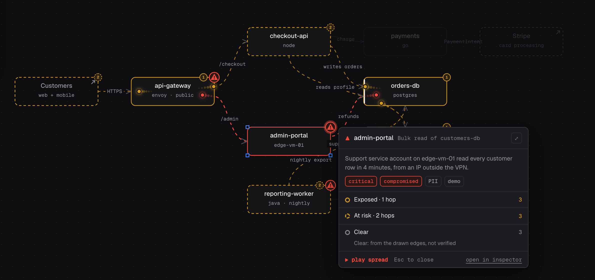

Use this when a scanner report or SIEM alert needs architectural context.
The board connects the finding to what the affected service can reach and what trusts it.

## You ask

```text
Use this SIEM alert and scanner report to mark affected services on the architecture board. Separate evidence of compromise from vulnerability findings. For each priority, explain reachability, sensitive data, exploit evidence and available fixes. Cite the source and list missing dependencies.
```

The agent needs your alert or access to your SIEM or scanner through another tool.
The board does not scan your infrastructure itself.

## What happens

- The agent marks services identified by SIEM alerts as `compromised` under the threat workflow.
- It marks actionable critical or high scanner findings as `vulnerable` when a fix exists or the CVE appears in KEV.
- It attaches the source, severity and context to each threat.

The `compromised` marker records the agent's interpretation of the alert.
It does not independently establish that an intrusion occurred.

## Inspect the impact



[Open the demo board →](https://draw.redcrayon.ai/#s=0e265bfd5eee31353e7cc39ec824771e)

Open a threat marker to inspect its blast radius. Direction and depth controls
help you follow the drawn dependencies. A missing connection can hide impact.
A node marked clear is not a verified safe system.

## Make the priority explicit

```text
Compare these two findings. Which needs containment first, and which can wait for a patch window? Explain the decision using the alert evidence, exposure and sensitive downstream systems. Do not rank by node count alone.
```

Use a [red crayon mark](/use-cases/feedback/) to ask about a missing service or
an unsupported priority. **Mark contained** records a decision in draw.
It does not isolate a service, patch software or close the source alert.

[Threats](/capabilities/threats/) · [Sharing threats](/capabilities/boards/#sharing) ·
[Data and consent](/data-and-consent/)
