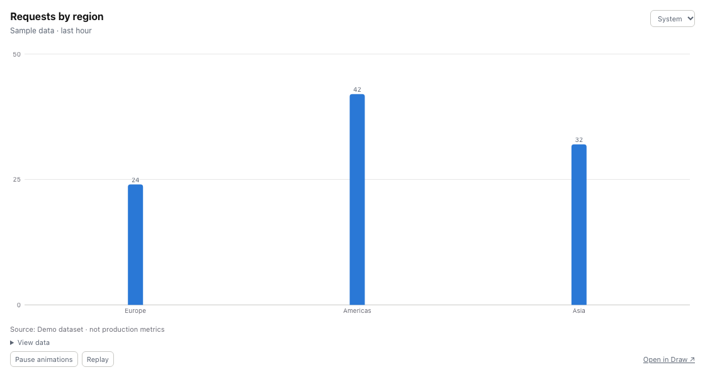

Use this after an investigation, design discussion or review. The right sharing
choice depends on whether readers need the whole board, one chart or continuing access.

## Prepare the result

```text
Turn this investigation board into a handover. Keep the relevant services and measured charts visible. Add short explanations of the findings and unresolved questions. Inspect chart source labels and notes for details we must not publish.
```

Snippet consent controls captured code text. It does not redact text or chart
data that your agent writes onto the board.

## Choose the audience

| Reader needs | Use |
|---|---|
| The interactive board | A view link, with code and threats chosen explicitly |
| To help edit or review | Signed-in edit access or a workspace board grant |
| One chart inside a report | A chart embed with its own access link |
| The visible diagram inside a page | A whole-board embed |

## Send a board link

Open **Share**, enable **Share with link**, and choose **Can view**.
Leave **Code** and **Threats** off unless the reader needs them.
Anyone holding this link can view the included content.

An edit link requires sign-in for editing and always includes code refs.
Stored snippets appear only when the board's owner also consents to storage.
Read [Boards and sharing](/capabilities/boards/#sharing) before enabling an edit link.

## Publish only a chart or diagram

As the owner, choose **Embed chart** for a selected chart, or **Embed board**
for the diagram. Enable **Enable embed access**, then copy the URL or iframe HTML.

A chart embed publishes its complete CSV and source, not only the points visible
in the plot. A board embed publishes visible labels, connections and charts,
including future changes. Neither publishes code refs or node docs.

Embed links work independently of board sharing. Anyone with the URL can read
the published content. A private page containing the embed does not protect that URL.

For Notion, paste the URL into an `/embed` block. For a webpage, use the iframe
HTML. Notion compatibility across web, desktop and mobile is not yet verified.
See [Embeds](/capabilities/embeds/) for access and playback details.



A chart embed shows the published chart without the board editor. These values are sample data.

## End access

Turn off board link sharing to revoke that link. Turn off **Enable embed access**
to revoke that embed, including open viewers. These are separate controls.
Neither control retracts copies that readers already saved.

For continuing team access, use [Workspaces](/capabilities/workspaces/).
